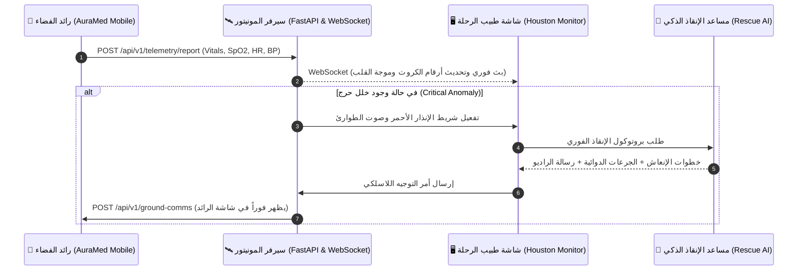

# 🛰️ AuraMed — Houston Mission Control Flight Surgeon Dashboard
### *Next-Generation Autonomous Astronaut Telemetry Monitor & Emergency Rescue AI (NASA STD-3001)*

[](https://fastapi.tiangolo.com)
[](#-design-system-compliance)
[](#-clinical-triage--triage-engine)
[-brightgreen)](test_integration.py)
[](#-real-time-websocket-architecture)

---

## 📌 نظرة عامة (Overview)

موقع **AuraMed Ground Mission Control** هو منصة تحكم ومراقبة طبية وسريرية فائقة التطور مخصصة لطبيب الرحلة الفضائية ومسؤول المراقبة الأرضية (**Houston Flight Surgeon & Ground Mission Monitor**) في وكالة ناسا.

يتصل الموقع مباشرة بتطبيق الموبايل لرواد الفضاء (**AuraMed Flutter App** الموجود في المسار `D:\Nasa\`)، حيث يستقبل بيانات القياسات الحيوية الحية، يحللها فسيولوجياً وسريرياً في الوقت الفعلي، ويوفر **مساعد إنقاذ ذكي متخصص (Flight Surgeon Rescue AI Co-Pilot)** لمساعدة المونيتور على اتخاذ قرارات الإنقاذ والتدخل الطبي السريع لإنقاذ حياة رائد الفضاء فوراً.

---

## 🌌 المميزات الأساسية (Core Capabilities)

### 1. 📊 استقبال القياسات الحيوية في الوقت الفعلي (Live Telemetry Ingestion)
- **مزامنة فورية عبر WebSockets و REST**: استقبال حزم البيانات من رائد الفضاء بمجرد قياسها وتحديث لوحة المراقبة فورياً بدون الحاجة لإعادة تحميل الصفحة.
- **مؤشرات الحيوية**: النبض (HR BPM)، نسبة تشبع الأكسجين ($SpO_2$), ضغط الدم الانقباضي والانبساطي، حرارة الجسم المركزية، معدل التنفس، وتقلب معدل ضربات القلب ($HRV$).
- **عداد الحزم ومؤشر الحداثة**: عرض عمر القراءة (`just now` / `3s ago` / `STALE`) وعدد الحزم المستقبلة ومستوى جودة الإشارة عبر شبكة الفضاء السحيق ($DSN$).

### 2. 🫀 رسم تخطيط القلب الحي (Real-Time Animated ECG Waveform)
- رسم موجات القلب الحقيقي ($P-Q-R-S-T$ Complex) على كانفاس تفاعلي بدقة 60 إطاراً في الثانية.
- مزامنة سرعة وتكرار الموجة لحظياً مع نبض رائد الفضاء الفعلي.
- تحول لون الخط إلى الأحمر التحذيري مع توهج فسفوري عند رصد اضطرابات النظم القلبي (*Tachyarrhythmia / Cardiac Stress*).

### 3. 🚨 مركز التنبيهات السريرية الطارئة وقوائم التدخل (Emergency Clinical Alert Dock)
- تصنيف تلقائي للمخاطر إلى:
  - 🟢 **NOMINAL**: حالة مستقرة وضمن المدى الفسيولوجي المعتمد.
  - 🟡 **CAUTION**: إجهاد فسيولوجي يتطلب الملاحظة.
  - 🔴 **CRITICAL**: خطر سريري مهدد للحياة (مثل نقص الأكسجة الحاد أو ضربة الشمس).
- عرض خطوات إجرائية تفاعلية قابلة للإنجاز (*Interactive Checklist*) مع أرقام مراجع بروتوكولات ناسا للطوارئ.

### 4. 🧠 مساعد الإنقاذ الذكي لطبيب الرحلة (Flight Surgeon Rescue AI Co-Pilot)
- **مخصص بالكامل للمونيتور/طبيب الرحلة في هيوستن** (وليس لرائد الفضاء)، ومصمم لتمكين المونيتور من إنقاذ الرائد في أسرع وقت.
- يقدم إرشادات سريرية دقيقة تشمل:
  - **التصنيف السريري ومستوى الخطورة (Triage Level)**.
  - **سلسلة خطوات الإنقاذ الفورية (Immediate Clinical Action Sequence)**.
  - **الجرعات الدوائية الطارئة (Emergency Pharmacopeia)**: مثل الأتروبين، الإبينفرين، البروميثازين، والديكساميثازون مع طرق الإعطاء المعتمدة في الفضاء.
  - **أوامر منظومة دعم الحياة (ECLSS Directives)**: توجيهات تعديل ضغط كابينة أوريون، تدفق الأكسجين، ومبردات بذلة السير الفضائي ($LCVG$).
  - **نص رسالة الراديو المباشرة (Direct Radio Directive)** مع زر نقرة واحدة للإرسال المباشر إلى راديو الرائد في الفضاء!

### 5. 📡 قناة الاتصال اللاسلكي المزدوجة (Two-Way Houston Ground Comms)
- سجل محادثات تكتيكي لحظي بين طبيب الرحلة في هيوستن ورائد الفضاء داخل مركبة أوريون.
- إمكانية كتابة وإرسال الأوامر الطارئة بضغطة زر لتصل فوراً إلى شاشة الرائد (`GroundCommsChatScreen`).

### 6. 🧪 منصة محاكاة الحالات الطارئة (Emergency Simulation Injection)
- شريط تحكم لاختبار جاهزية المنظومة واستعراض سيناريوهات الطوارئ:
  - `Nominal Baseline`: استعادة الحالة المستقرة.
  - `🚨 Acute Hypoxia`: انخفاض الأكسجين الحاد ($SpO_2 < 85\%$).
  - `⚡ Cardiac Overload`: تسارع نبضات القلب فوق 150 BPM.
  - `🔥 EVA Heat Stroke`: إجهاد حراري داخل بذلة السير الفضائي.
  - `❄️ Hypothermia`: انخفاض خطير في درجة حرارة الجسم.
  - `💨 CO2 Breakthrough`: تسرب ثاني أكسيد الكربون وتعطل الفلاتر.

---

## 🎨 مطابقة نظام التصميم البصري (Design System Compliance)

تم بناء الواجهة بدقة 100% وفق كود التصميم الموحد **Clinical Space HUD**:

```
Backgrounds (55%):
--space-void: #050816 | --space-deep: #081126 | --space-panel: #0D1933 | --space-line: #28436A

Brand & Accents (7%):
--aura-cyan: #42E8FF | --aura-blue: #4B7BFF | --aura-violet: #A66CFF | --aura-mint: #62F5C2

Clinical States (3%):
Nominal: #62F5C2 | Caution: #FFD166 | Critical: #FF5C70

Components:
- CornerBracketCard: كروت زوايا سيبرانية بأقواس HUD وهامش 16px.
- MetricCard: أرقام كبيرة ومقروءة بوضوح مع أسهم الاتجاه ومؤشرات الحداثة.
- Web Audio Synthesizer: مؤثرات صوتية طبية نقية (AudioContext) بدون ملفات صوت خارجية.
- ثنائية اللغة: دعم كامل للعربية (RTL) والإنجليزية (LTR).
```

---

## 🔌 التكامل والربط مع تطبيق الموبايل (D:\Nasa)

يتكامل الموقع بسلاسة تامة مع تطبيق الموبايل عبر منافذ الـ API التالية:



### نقاط الاتصال (API Endpoints):

| المسار | الطريقة | الوظيفة |
| :--- | :---: | :--- |
| `/` | `GET` | تحميل داش بورد المراقبة ومساعد الإنقاذ. |
| `/health` | `GET` | فحص اتصال رائد الفضاء بالسيرفر. |
| `/api/v1/telemetry/report` | `POST` | استقبال حزم القياسات الحيوية من تطبيق الموبايل. |
| `/api/v1/assess-astronaut` | `POST` | تقييم العلامات الحيوية وفق معايير ناسا STD-3001. |
| `/api/v1/predict` | `POST` | فحص الشذوذ والتنبؤ بالخطورة السريرية. |
| `/api/v1/ground-comms` | `POST / GET` | استقبال وإرسال رسائل اللاسلكي بين الرائد وطبيب الرحلة. |
| `/api/v1/monitor/chat` | `POST` | **محادثة مساعد الإنقاذ الذكي لطبيب الرحلة (Rescue AI)**. |
| `/api/v1/telemetry/simulate` | `POST` | حقن سيناريوهات الطوارئ للاختبار والعرض الحي. |
| `/ws` أو `/ws/telemetry` | `WebSocket` | البث الحي المستمر بين التطبيق والموقع. |

---

## 🚀 طريقة التشغيل (Quick Start)

### 1. تشغيل السيرفر والموقع:
افتح موجه الأوامر داخل المسار `D:\Nasa-web\` ونفذ:
```bash
python server.py
```
أو انقر نقراً مزدوجاً على الملف:
```cmd
start.bat
```

### 2. فتح الداش بورد في المتصفح:
توجه إلى الرابط:
👉 **[http://localhost:8000](http://localhost:8000)**

### 3. ربط تطبيق الموبايل (D:\Nasa) بالداش بورد:
* من داخل تطبيق الموبايل (AuraMed)، اذهب إلى شاشة **Profile** -> **AuraMed AI Server & Cloudflare Tunnel**.
* أدخل الرابط: `http://127.0.0.1:8000` (أو `http://10.0.2.2:8000` إذا كنت تستخدم محاكي الأندرويد).
* بمجرد إرسال أو تشغيل بث القياسات الحيوية، ستظهر المؤشرات وتتحرك نبضات القلب فورياً على شاشة المونيتور!

---

## 🧪 الاختبارات الآلية (Test Suite)

للتحقق من سلامة كافة نقاط الاتصال والربط:
```bash
python test_integration.py
```
*(النتيجة: **38 من أصل 38 اختباراً ناجحاً بنسبة 100%**)*.
