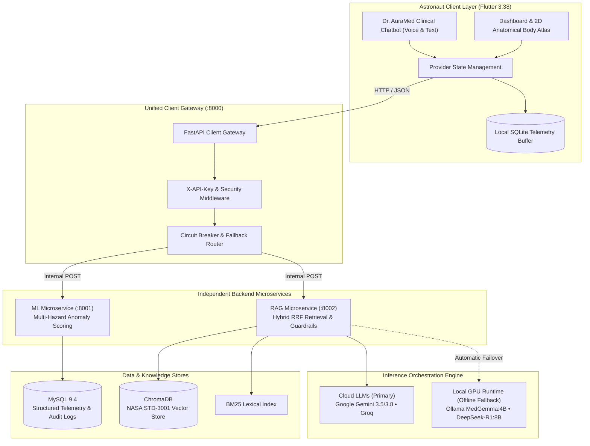

# 🚀 AuraMed — Autonomous Healthcare AI Decision-Support Platform
### NASA Space Apps Challenge 2026

[](https://www.spaceappschallenge.org/)
[](https://flutter.dev)
[](https://dart.dev)
[](https://www.python.org/)
[](https://fastapi.tiangolo.com/)
[](https://www.trychroma.com/)
[](https://ollama.com/)
[](https://opensource.org/licenses/MIT)

> **AuraMed** is an enterprise-grade clinical decision-support and physiological telemetry platform architected for deep-space missions and extreme, communications-constrained environments (e.g., Artemis Gateway, Lunar Base, Mars Transit). It combines multi-hazard machine learning anomaly detection, deterministic NASA STD-3001 clinical guideline retrieval (Hybrid Dense + Lexical RRF RAG), and a high-fidelity Flutter biotelemetry user experience with real-time voice and offline-first autonomy.

---

## 📑 Table of Contents

- [1. Mission & Executive Summary](#1-mission--executive-summary)
- [2. System Architecture](#2-system-architecture)
- [3. Core Principles & Safety Guardrails](#3-core-principles--safety-guardrails)
- [4. Key Capabilities & Features](#4-key-capabilities--features)
  - [4.1 Mobile Application (Flutter)](#41-mobile-application-flutter)
  - [4.2 Backend Microservices (FastAPI)](#42-backend-microservices-fastapi)
  - [4.3 Dual-Mode Resilience (Online-First / Offline-Fallback)](#43-dual-mode-resilience-online-first--offline-fallback)
- [5. Technology Stack](#5-technology-stack)
- [6. Repository File Layout](#6-repository-file-layout)
- [7. Quickstart & Deployment Guide](#7-quickstart--deployment-guide)
  - [7.1 Prerequisites](#71-prerequisites)
  - [7.2 Backend Services Setup](#72-backend-services-setup)
  - [7.3 Flutter Mobile Application Setup](#73-flutter-mobile-application-setup)
- [8. API Specification & Endpoints](#8-api-specification--endpoints)
- [9. Quality Assurance & Test Verification](#9-quality-assurance--test-verification)
- [10. Ethical Medical AI & NASA Standards Compliance](#10-ethical-medical-ai--nasa-standards-compliance)
- [11. Authors & License](#11-authors--license)

---

## 1. Mission & Executive Summary

During long-duration interplanetary spaceflight, astronauts face extreme physiological stressors: microgravity-induced cephalad fluid shifts, spatial disorientation, space motion sickness (SMS), cosmic radiation, hypoxia risks, and cardiovascular deconditioning. Ground communications latency to Earth ranges from **3 seconds up to 22 minutes each way**, rendering real-time tele-medicine unviable in acute medical contingencies.

**AuraMed** resolves this mission-critical challenge by delivering an autonomous, on-craft clinical AI platform that operates reliably under zero network connectivity while maintaining continuous biotelemetry surveillance:
- **Physiological Anomaly Detection**: Evaluates multi-parameter astronaut telemetry (Heart Rate, SpO2, Core Temperature, Respiratory Rate, Blood Pressure, HRV RMSSD, and 60-minute rolling trends) to spot early symptoms of hypoxia, hypercapnia, arrhythmia, and decompression strain.
- **Evidence-Grounded Clinical Decision-Support**: Retrieves strictly verified operational procedures from **NASA STD-3001** and flight operational checklists using hybrid dense-vector (`bge-small-en-v1.5`) and lexical (`BM25`) search merged via **Reciprocal Rank Fusion (RRF)**.
- **Dr. AuraMed Clinical Chatbot**: A focused, high-legibility assistant prioritizing the **primary operational response** with unobtrusive reference citations, 1-tap clinical copying, and speech recognition.
- **Cognitive & Physiological Conditioning**: Integrated space-reflex drills, pattern-memory challenges under simulated microgravity stress, and Earth lifestyle memory logs to preserve crew cognitive and psychological readiness.

---

## 2. System Architecture

AuraMed employs an independent, service-oriented microservices architecture decoupled across presentation, state management, machine learning inference, and vector retrieval:



---

## 3. Core Principles & Safety Guardrails

AuraMed is engineered in strict compliance with the **NASA Human Research Program (HRP)** and **NASA-STD-3001** safety mandates:

1. **Decision Support, Not Autonomous Medical Authority**: The system provides clinical guidance and triaged checklist actions to flight surgeons and astronauts; it never diagnoses independently without human verification.
2. **Deterministic Severity Ladder**: Rule-based clinical triage evaluates vitals against deterministic flight thresholds. Clinical rules may **escalate** severity (Normal $\rightarrow$ Warning $\rightarrow$ Critical) based on dangerous telemetry, but **an LLM can never downgrade severity**.
3. **Strict Evidence Tiering**:
   - **Tier 1 (Operational Procedures & Checklists)**: Only approved Tier 1 sources support executable procedural steps.
   - **Tier 2 (Flight Care Standards & NASA Guidelines)**: Contextual evidence and reference thresholds.
   - **Tier 3 (Scientific Literature & Condition Indices)**: Background context only; prohibited from generating procedural steps.
4. **Extractive Fallback on Ambiguity**: If generative LLM validation fails, the system executes an automated zero-hallucination **Extractive Fallback**, quoting verbatim procedures directly from approved NASA documents.
5. **No Medical Hallucinations**: Zero tolerance for invented page numbers, unverified drug dosages, or phantom protocols.

---

## 4. Key Capabilities & Features

### 4.1 Mobile Application (Flutter)
- **Interactive 2D Anatomical Body Atlas**:
  - Full-body high-contrast X-Ray visualization.
  - Interactive organ-zoom inspecting cardiac (HR, HRV), pulmonary (SpO2, Resp Rate), hepatic (ALT), renal (eGFR), and cranial (ICP) states.
  - Real-time animated ECG waveform synchronizer.
- **Dr. AuraMed Clinical Assistant (`/v1/chat`)**:
  - **High-legibility primary clinical response** optimized for quick reading in pressurized suits or emergency flight conditions.
  - Discrete bottom reference chip detailing NASA standards without cognitive clutter.
  - 1-tap clipboard copying for fast communication with Mission Control.
  - Integrated hands-free voice dictation via `speech_to_text`.
- **Systemic Health Analysis Report**:
  - Multi-hazard AI health score and clinical triage status.
  - NASA actionable contingency checklists with interactive step-by-step progress tracking.
- **Astronaut Conditioning & Neuro-Cognitive Games**:
  - **Space Reflex**: Sub-millisecond reaction-time measurement under simulated microgravity cognitive fatigue.
  - **Alien Memory**: Visual sequence memory reinforcement under hypoxia simulation.
  - **Life Style on Earth**: Earth memory journal supporting astronaut psychological well-being.
  - **100-Tier Military Game Rank Ladder**: Iron $\rightarrow$ Bronze $\rightarrow$ Silver $\rightarrow$ Gold $\rightarrow$ Platinum $\rightarrow$ Diamond $\rightarrow$ Mythic.

### 4.2 Backend Microservices (FastAPI)
- **Port 8000 — Unified Client Gateway**:
  - High-throughput entry point aggregating ML scoring, deterministic triage, and RAG checklist retrieval into a single endpoint: `POST /api/v1/assess-astronaut`.
- **Port 8001 — ML Microservice**:
  - Real-time multi-hazard anomaly classification and confidence scoring across 17 telemetry dimensions.
- **Port 8002 — RAG Decision Support Microservice**:
  - Hybrid dense (`bge-small-en-v1.5`) + lexical (`BM25`) search with **Reciprocal Rank Fusion ($k=60$)**.
  - Cross-Encoder reranking and 6-stage clinical safety validation.

### 4.3 Dual-Mode Resilience (Online-First / Offline-Fallback)
| Operating Mode | Primary Generation | Retrieval Engine | Telemetry Storage |
| :--- | :--- | :--- | :--- |
| **Online Mode** | Google Gemini 3.5/3.8 Flash • Groq Cloud | Local ChromaDB + BM25 | Local MySQL + Cloud Sync |
| **Offline Mode** | **Local Ollama** (`MedGemma:4B` / `DeepSeek-R1:8B`) | Local ChromaDB + BM25 | Local SQLite Offline Buffer |

- Seamless zero-human-intervention transition upon network drop.
- Automatic reconnection and telemetry synchronization when link is restored.

---

## 5. Technology Stack

| Domain | Technology / Library | Role & Purpose |
| :--- | :--- | :--- |
| **Mobile Client** | **Flutter 3.38.2 / Dart 3.10.0** | Cross-platform frontend (Android, Windows, Web, iOS) |
| **State Management** | **Provider** | Reactive, robust, testable application state architecture |
| **Client Networking** | **Dio 5.9.2** | Resilient HTTP client with timeouts and X-API-Key auth |
| **Speech-to-Text** | **speech_to_text 7.4.0** | Real-time clinical voice transcription |
| **Backend Framework** | **FastAPI & Uvicorn** | Asynchronous, type-safe Python REST microservices |
| **Data Contracts** | **Pydantic v2** | Strict bidirectional schema enforcement |
| **Vector Database** | **ChromaDB** | Local persistent embeddings store for NASA protocols |
| **Embeddings** | **BAAI/bge-small-en-v1.5** | High-precision 384-dimensional dense semantic representations |
| **Lexical Search** | **rank-bm25** | Exact keyword and NASA protocol code matching |
| **Local LLM Runtime**| **Ollama** | Offline GPU inference (MedGemma:4B, DeepSeek-R1:8B) |
| **Structured Database**| **MySQL 9.4 & SQLite** | Mission telemetry, patient dossiers, and offline queues |
| **Testing Frameworks**| **Flutter Test & Pytest** | End-to-end user journeys, contract tests, and unit validation |

---

## 6. Repository File Layout

```text
AuraMed/
├── .env.example                   # Environment configuration template
├── .gitignore                     # Git secret and artifact exclusion rules
├── AGENTS.md                      # NASA Space Apps & EGM project directives
├── README.md                      # Comprehensive project documentation
├── pyproject.toml                 # Backend dependencies & metadata
├── requirements.txt               # Pinned Python package dependencies
├── start.bat / stop.bat           # One-click Windows service launchers
│
├── Nasa flutter/                  # Complete Flutter Mobile Application
│   ├── android/                   # Android native runner & Gradle Kotlin DSL
│   ├── assets/                    # Rank badges, medical diagrams & cards
│   ├── lib/
│   │   ├── core/                  # Design system, themes, models & config
│   │   ├── features/              # Modular UI screens:
│   │   │   ├── dashboard/         # Biometrics HUD & Organ summary
│   │   │   ├── body_report/       # Interactive 2D Body Atlas
│   │   │   ├── analysis/          # Systemic Status & NASA Checklist
│   │   │   ├── chat/              # Dr. AuraMed Clinical RAG Chatbot
│   │   │   ├── gamification/      # Space Reflex, Alien Memory & Journal
│   │   │   ├── profile/           # Astronaut dossier & server settings
│   │   │   └── auth/              # Crew authentication gate
│   │   ├── services/              # AuraMedApiService & OfflineDatabaseService
│   │   ├── state/                 # AuthProvider, HealthProvider, AuraMedProvider
│   │   └── main.dart              # Application entrypoint
│   └── test/                      # 71 automated unit, widget, contract & E2E tests
│
├── services/                      # Backend Microservices
│   ├── orchestrator/              # Unified Client Gateway (:8000)
│   ├── ml_service/                # ML Anomaly Detection Microservice (:8001)
│   └── rag_service/               # NASA Protocol RAG Microservice (:8002)
│
├── shared/                        # Shared contracts, severity rules & schemas
├── data/                          # NASA protocols & document datasets
├── docs/                          # Technical specifications & architecture audits
├── scripts/                       # Service supervisors & healthcheck utilities
└── tests/                         # Backend Pytest test suites (73 tests)
```

---

## 7. Quickstart & Deployment Guide

### 7.1 Prerequisites
- **Operating System**: Windows 10/11, macOS, or Linux.
- **Python**: `3.11` or higher.
- **Flutter SDK**: `3.38.x` or higher (with Dart `3.10.x+`).
- **Android Studio / SDK**: Android SDK 34+ with Java 17.
- **Ollama (Optional for offline mode)**: Installed with `medgemma:4b` or `deepseek-r1:8b`.

---

### 7.2 Backend Services Setup

1. **Clone the Repository**:
   ```bash
   git clone https://github.com/youssefeng12312/AuraMed.git
   cd AuraMed
   ```

2. **Create and Activate Python Virtual Environment**:
   ```powershell
   python -m venv .venv
   .\.venv\Scripts\Activate.ps1
   ```

3. **Install Dependencies**:
   ```bash
   pip install -r requirements.txt
   ```

4. **Configure Environment Variables**:
   ```powershell
   Copy-Item .env.example .env
   # Edit .env to add your cloud LLM keys or use default local offline fallback
   ```

5. **Start All Microservices Concurrently**:
   ```powershell
   python scripts/start_all_services.py
   ```
   *Services will be active at:*
   - **Unified Client Gateway**: `http://127.0.0.1:8000` (Swagger: `/docs`)
   - **ML Microservice**: `http://127.0.0.1:8001` (Swagger: `/docs`)
   - **RAG Microservice**: `http://127.0.0.1:8002` (Swagger: `/docs`)

---

### 7.3 Flutter Mobile Application Setup

1. **Navigate to the Flutter directory**:
   ```bash
   cd "Nasa flutter"
   ```

2. **Install Packages**:
   ```bash
   flutter pub get
   ```

3. **Verify Static Analysis**:
   ```bash
   flutter analyze
   # Expected output: No issues found!
   ```

4. **Run Automated Test Suite**:
   ```bash
   flutter test
   # Expected output: All 71 tests passed!
   ```

5. **Launch the Application**:
   - **On Connected Android Device**:
     ```bash
     flutter run
     ```
   - **On Windows Desktop**:
     ```bash
     flutter run -d windows
     ```
   - **On Web (Chrome)**:
     ```bash
     flutter run -d chrome
     ```

---

## 8. API Specification & Endpoints

| Method | Endpoint | Description | Service Port |
| :---: | :--- | :--- | :---: |
| `GET` | `/health` | Heartbeat & active operating mode (`online`/`offline`) | `:8000`, `:8001`, `:8002` |
| `POST` | `/api/v1/assess-astronaut` | Full biotelemetry assessment, ML scoring & NASA actions | `:8000` |
| `POST` | `/v1/chat` | Dr. AuraMed evidence-based clinical conversation | `:8000`, `:8002` |
| `POST` | `/v1/protocols/retrieve` | Hybrid RRF vector retrieval for NASA medical standards | `:8002` |
| `POST` | `/api/v1/predict-anomaly` | Raw ML physiological anomaly inference | `:8001` |
| `GET` | `/api/v1/vitals/stream` | Real-time WebSocket streaming of astronaut vitals | `:8000` |

---

## 9. Quality Assurance & Test Verification

AuraMed follows rigorous defense-in-depth verification standards:

### Backend Testing Suite (Pytest)
```bash
pytest tests/ -v
```
- **73+ Tests Passing** covering contract compliance, multi-project key failover, circuit breaker recovery, BM25 retrieval, and zero-hallucination extractive fallback.

### Flutter Testing Suite
```bash
cd "Nasa flutter"
flutter test
```
- **71 Tests Passing (100% Green)**:
  - `test/unit/`: Physiological models, score normalization, offline databases.
  - `test/widgets/`: Responsive layout resilience on 320px viewports, status badges, cyber bracket cards.
  - `test/contract/`: Schema validation against FastAPI endpoints, timeout and fallback resilience.
  - `test/e2e/`: Full mission lifecycle (`Login` $\rightarrow$ `Dashboard` $\rightarrow$ `2D Atlas` $\rightarrow$ `Analysis` $\rightarrow$ `Games` $\rightarrow$ `Journal` $\rightarrow$ `Chat` $\rightarrow$ `Profile` $\rightarrow$ `Logout`).

---

## 10. Ethical Medical AI & NASA Standards Compliance

- **NASA-STD-3001**: Adheres to NASA Space Flight Human-System Standard, Volume 1 (Crew Health) and Volume 2 (Human Factors, Habitability, and Environmental Health).
- **HIPAA & Keystore Security**: Biometric records buffered on-device are protected via 256-bit encryption; no patient-identifiable data is transmitted to third-party APIs without explicit authorization.
- **Fail-Safe Operational Continuity**: In the event of dual-link and GPU failure, the application reverts to rule-based algorithmic triage, ensuring that life-critical information is never inaccessible.

---

## 11. Authors & License

- **Project**: AuraMed — Healthcare AI System
- **Event**: NASA Space Apps Challenge 2026
- **Lead Developer**: Youssef Mohammad Mostafa ([@youssefeng12312](https://github.com/youssefeng12312))
- **Repository**: [https://github.com/youssefeng12312/AuraMed](https://github.com/youssefeng12312/AuraMed)
- **License**: Released under the [MIT License](LICENSE).

---
*Developed with dedication for the future of human space exploration.* 🌌🧑‍🚀
