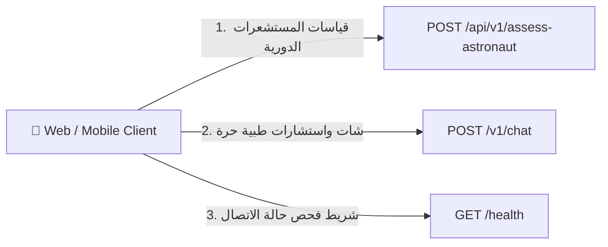

# دليل تكامل الـ API لمطوري الويب والموبايل (Frontend Integration Guide)
## نظام AuraMed للرعاية الصحية في الفضاء — NASA Space Apps Challenge 2026

مرحباً بفريق تطوير الـ **Web** والـ **Mobile**! 🚀  
هذا الدليل أُعد خصيصاً لكم ليجعل عملية ربط الواجهات مع الباك إند (Backend APIs) سريعة، واضحة، وخالية من أي تعقيد.

> [!IMPORTANT]
> **تنبيه معمارية الربط لمطوري الموبايل (Flutter):**
> صفحة `index.html` (أو مسار `/`) هي مجرد **Interactive Testing Studio** مخصصة للتجربة السريعة والفحص البصري للمطورين أثناء البناء.
> تطبيق **Flutter** سيتعامل حصرياً وبشكل أصيل (Native) مع الـ REST APIs الموضحة أدناه عبر كود Dart و HTTP Requests (`package:http` أو `dio`) لمعالجة كائنات الـ JSON، دون استخدام أي WebView.


---

## 📌 1. العناوين الرئيسية للسيرفر (Base URLs)

فريق الفرونت إند يحتاج فقط للتواصل مع **بوابة العميل الموحدة (Gateway) على Port 8000**. البوابة تتكفل تلقائياً بالتنسيق مع الذكاء الاصطناعي (ML) والبحث في وثائق ناسا (RAG) وقواعد البيانات.

| البيئة | الـ Base URL | ملاحظات |
| :--- | :--- | :--- |
| **تطبيق الويب (Web - React / Next.js / Vue)** | `http://127.0.0.1:8000` | شغال مباشرة مع تفعيل كامل لـ CORS |
| **محاكي أندرويد (Android Emulator)** | `http://10.0.2.2:8000` | أندرويد يعتبر `10.0.2.2` هو الـ localhost لجهاز الكمبيوتر |
| **محاكي آبل (iOS Simulator)** | `http://127.0.0.1:8000` | يعمل مباشرة |
| **جهاز حقيقي (Real Phone on Wi-Fi)** | `http://<IP_جهاز_الكمبيوتر>:8000` | تأكد أن الهاتف والكمبيوتر على نفس شبكة الواي فاي |
| **واجهة Swagger التفاعلية للتجربة** | `http://127.0.0.1:8000/docs` | واجهة مرئية لتجربة أي API بضغطة زر وبدون كود |

---

## 🚀 2. الـ APIs الأساسية ومسؤولية كل واحد منها

النظام يقدم **3 نقاط اتصال (Endpoints)** رئيسية تلبي كل متطلبات التطبيق:



---

### 🔹 API 1: التقييم السريري الشامل (`POST /api/v1/assess-astronaut`)
* **الهدف:** هذا هو الـ API الرئيسي في النظام. يُرسل إليه التطبيق قراءات أجهزة الاستشعار (النبض، الأكسجين، الضغط، إلخ) كل فترة، أو عند حدوث طارئ، ليعيد تشخيصاً فورياً وإجراءات إسعافية دقيقة ومعتمدة من ناسا.

#### 📨 الطلب (Request Body - JSON):
```json
{
  "request_id": "REQ-2026-001",
  "astronaut_id": "ASTRO-01",
  "vitals": {
    "request_id": "REQ-2026-001",
    "astronaut_id": "ASTRO-01",
    "heart_rate_bpm": 135.0,
    "hrv_rmssd_ms": 22.0,
    "spo2_percent": 86.5,
    "body_temperature_c": 37.4,
    "respiratory_rate_bpm": 26.0,
    "systolic_bp_mmhg": 118.0,
    "diastolic_bp_mmhg": 75.0,
    "heart_rate_bpm_rolling_mean_60min": 78.0,
    "heart_rate_bpm_rolling_std_60min": 4.1,
    "hrv_rmssd_ms_rolling_mean_60min": 48.0,
    "hrv_rmssd_ms_rolling_std_60min": 3.9,
    "spo2_percent_rolling_mean_60min": 98.0,
    "spo2_percent_rolling_std_60min": 1.1,
    "body_temperature_c_rolling_mean_60min": 36.8,
    "body_temperature_c_rolling_std_60min": 0.2,
    "respiratory_rate_bpm_rolling_mean_60min": 15.0,
    "respiratory_rate_bpm_rolling_std_60min": 1.2
  }
}
```

> **ملاحظة:** إذا لم تتوفر لديك كل الحقول الإحصائية الـ 17، يكفي إرسال الحقول الأساسية السبعة (`heart_rate_bpm`, `spo2_percent`, `body_temperature_c`, `respiratory_rate_bpm`, `systolic_bp_mmhg`, `diastolic_bp_mmhg`, `hrv_rmssd_ms`).

#### 📬 الرد (Response Body - JSON):
```json
{
  "request_id": "REQ-2026-001",
  "astronaut_id": "ASTRO-01",
  "status": "ok",
  "operating_mode": "online",
  "active_provider": "cloud",
  "severity": "Critical",
  "condition_hypotheses": [
    "hypoxia_suspected",
    "tachycardia_moderate"
  ],
  "ml_assessment": {
    "anomaly_detected": true,
    "anomaly_label": 1,
    "confidence_score": 0.98,
    "hazard_risk_level": "Critical_Risk",
    "predicted_degradation_score": 68.4
  },
  "summary": "CRITICAL PROTOCOL ESCALATION: Immediate consultation with NASA Flight Surgeon required. Begin emergency supportive stabilization. Crew member exhibiting acute oxygen desaturation (SpO2: 86.5%) with compensatory tachycardia.",
  "action_steps": [
    {
      "n": 1,
      "action": "Don Quick-Don Mask immediately and verify positive pressure seal.",
      "source_chunk_id": "chk_revk_oxygen_p226_01",
      "ref_label": "JSC-48031 Medical Checklist Rev K PCN-4, p.226",
      "warning": "Ensure oxygen supply valve is set to Emergency 15 L/min flow rate."
    },
    {
      "n": 2,
      "action": "Connect Quick Disconnect to Shuttle/Station oxygen port LEH O2 8.",
      "source_chunk_id": "chk_revk_oxygen_p226_02",
      "ref_label": "JSC-48031 Medical Checklist Rev K PCN-4, p.226",
      "warning": null
    }
  ],
  "escalation": {
    "required": true,
    "reason": "SpO2 dropped below critical threshold (<= 88.0%)",
    "target": "Flight Surgeon"
  },
  "protocol_references": [
    "JSC-48031 Medical Checklist Rev K PCN-4, p.226",
    "NASA-STD-3001 Vol 1A, p.42"
  ],
  "total_latency_ms": 940.2
}
```

#### 🎨 كيف تعرض هذه البيانات في واجهتك؟
1. **مؤشر الخطورة (`severity`):**
   - `Normal` 🟢 ⬅ اعرضه باللون الأخضر (الحالة مستقرة).
   - `Warning` 🟡 ⬅ اعرضه باللون البرتقالي (تحذير).
   - `Critical` 🔴 ⬅ اعرضه باللون الأحمر مع وميض وصوت تنبيه لطاقم المهمة.
2. **قائمة الإجراءات (`action_steps`):**
   - اعرضها كقائمة مهام تفاعلية (Interactive Checklist) مع خانات اختيار (Checkboxes) ليتتبع رائد الفضاء ما قام بتنفيذه خطوة بخطوة.
   - إذا كان حقل `warning` موجوداً (غير null)، اعرضه في شريط تحذيري مميز باللون الأصفر داخل الخطوة.
3. **مربع التصعيد (`escalation`):**
   - إذا كانت `required: true`، أظهر زراً كبيراً بارزاً: **"📞 اتصل بـ Flight Surgeon فوراً"**.

---

### 🔹 API 2: المساعد الطبي التفاعلي (`POST /v1/chat`)
* **الهدف:** شاشة محادثة ذكية وشاملة (AI Clinical Copilot) تتيح لرائد الفضاء أو الطبيب التحدث بحرية باللغة العربية أو الإنجليزية. يتعرف النظام بذكاء على قصد المستخدم:
  1. **المسار الحواري (`is_protocol: false`):** للأسئلة العامة، التحية، والاستفسارات العلمية والطبية الفضائية — يجيب الموديل برد طبي حواري فوري وموجز، وتكون `action_steps: []` خالية تماماً.
  2. **المسار البروتوكولي الطارئ (`is_protocol: true`):** عند الإبلاغ عن أعراض حادة أو قراءات حيوية مقلقة أو طلب بروتوكول إسعافي — يُرجع النظام خطوات تنفيذية موثقة من ناسا (`action_steps`) مع مؤشرات الخطورة ومحاذير الجاذبية الصغرى.

#### 📨 الطلب (Request Body - JSON):
```json
{
  "query": "Astronaut telemetry shows heart rate 145 bpm and palpitations. Request protocol.",
  "astronaut_id": "ASTRO-01"
}
```

#### 📬 الرد في حالة استفسار طارئ (`is_protocol: true`):
```json
{
  "query": "Astronaut telemetry shows heart rate 145 bpm and palpitations. Request protocol.",
  "astronaut_id": "ASTRO-01",
  "severity": "Critical",
  "summary": "Crew member experiencing severe tachycardia (145 bpm). Rest in recumbent position, apply continuous ECG telemetry, and administer supplemental O2 if symptomatic.",
  "response": "Crew member experiencing severe tachycardia (145 bpm). Rest in recumbent position, apply continuous ECG telemetry, and administer supplemental O2 if symptomatic.",
  "is_protocol": true,
  "action_steps": [
    {
      "n": 1,
      "action": "Place crew member in semi-recumbent position and tether to CMRS straps to minimize physical exertion.",
      "source_chunk_id": "chk_revk_cardio_p112_01",
      "ref_label": "JSC-48031 Medical Checklist Rev K, p.112",
      "warning": null
    }
  ],
  "escalation": {
    "required": true,
    "reason": "Heart rate sustained above 140 bpm",
    "target": "Flight Surgeon"
  },
  "protocol_references": [
    "JSC-48031 Medical Checklist Rev K, p.112"
  ],
  "active_provider": "cloud",
  "latency_ms": 1150.0
}
```

#### 📬 الرد في حالة استفسار حواري عام (`is_protocol: false`):
```json
{
  "query": "مرحبا أوراميد، كيف تؤثر الجاذبية الصغرى على عظام رواد الفضاء؟",
  "astronaut_id": "ASTRO-01",
  "severity": "Normal",
  "summary": "أهلاً بك! في بيئة الجاذبية الصغرى، يفقد رواد الفضاء ما يقارب 1% إلى 1.5% من كثافة المعادن في العظام شهرياً، وتحديداً في عظام الحوض والأطراف السفلية، بسبب غياب التحميل الميكانيكي المستمر للوزن. لمواجهة ذلك، تعتمد ناسا تمارين المقاومة اليومية عبر جهاز ARED مع جرعات مكملة من فيتامين D والكالسيوم.",
  "response": "أهلاً بك! في بيئة الجاذبية الصغرى، يفقد رواد الفضاء ما يقارب 1% إلى 1.5% من كثافة المعادن في العظام شهرياً...",
  "is_protocol": false,
  "action_steps": [],
  "escalation": {
    "required": false,
    "reason": "None",
    "target": "None"
  },
  "protocol_references": [],
  "active_provider": "cloud",
  "latency_ms": 820.0
}
```

#### 🎨 كيف يتعامل تطبيق Flutter مع هذا الرد؟
- إذا كان `is_protocol == false`: اعرض نص الـ `response` مباشرة كفقاعة رسالة محادثة عادية بدون رسم مربعات الاختيار (Checkboxes) أو تحذيرات الطوارئ.
- إذا كان `is_protocol == true`: اعرض نص الـ `response` وتحته مباشرة القائمة التفاعلية للخطوات `action_steps` ليتتبعها رائد الفضاء خطوة بخطوة.

---

### 🔹 API 3: فحص صحة النظام وحالة الاتصال (`GET /health`)
* **الهدف:** استدعاء خفيف وسريع لمعرفة حالة السيرفر وهل هو يعمل عبر الإنترنت (Groq Cloud) أم تحول تلقائياً إلى وضع الأوفلاين (Ollama Local).

#### 📬 الرد (Response Body - JSON):
```json
{
  "status": "healthy",
  "service": "auramed-client-gateway",
  "operating_mode": "online",
  "cloud_provider": "groq (openai/gpt-oss-120b)",
  "offline_fallback": "ollama (medgemma:latest)"
}
```

> **فكرة للفرونت إند:** يمكنك وضع أيقونة في الزاوية العلوية للتطبيق:
> - إذا كانت `operating_mode: "online"` ⬅ نقطة خضراء 🟢 مكتوب بجانبها: `Cloud Connected (Groq 120B)`.
> - إذا كانت `operating_mode: "offline"` ⬅ نقطة برتقالية 🟠 مكتوب بجانبها: `Offline Mode (Local Ollama)`.

---

## 💻 3. كود جاهز للنسخ لمطوري الموبايل (Flutter / Dart)

ملف خدمة كامل (`auramed_service.dart`) يمكنك وضعه مباشرة في مشروع الفلاتر:

```dart
import 'dart:convert';
import 'dart:io';
import 'package:http/http.dart' as http;

/// نماذج البيانات الخاصة بالردود (Dart Data Models)
class ActionStepModel {
  final int n;
  final String action;
  final String sourceChunkId;
  final String refLabel;
  final String? warning;

  ActionStepModel({
    required this.n,
    required this.action,
    required this.sourceChunkId,
    required this.refLabel,
    this.warning,
  });

  factory ActionStepModel.fromJson(Map<String, dynamic> json) {
    return ActionStepModel(
      n: json['n'] ?? 1,
      action: json['action'] ?? '',
      sourceChunkId: json['source_chunk_id'] ?? '',
      refLabel: json['ref_label'] ?? '',
      warning: json['warning'],
    );
  }
}

class ChatResponseModel {
  final String query;
  final String severity;
  final String summary;
  final String response;
  final bool isProtocol;
  final List<ActionStepModel> actionSteps;
  final bool escalationRequired;
  final String escalationTarget;

  ChatResponseModel({
    required this.query,
    required this.severity,
    required this.summary,
    required this.response,
    required this.isProtocol,
    required this.actionSteps,
    required this.escalationRequired,
    required this.escalationTarget,
  });

  factory ChatResponseModel.fromJson(Map<String, dynamic> json) {
    final stepsJson = json['action_steps'] as List? ?? [];
    return ChatResponseModel(
      query: json['query'] ?? '',
      severity: json['severity'] ?? 'Normal',
      summary: json['summary'] ?? '',
      response: json['response'] ?? json['summary'] ?? '',
      isProtocol: json['is_protocol'] ?? false,
      actionSteps: stepsJson.map((s) => ActionStepModel.fromJson(s)).toList(),
      escalationRequired: json['escalation']?['required'] ?? false,
      escalationTarget: json['escalation']?['target'] ?? 'None',
    );
  }
}

class AuraMedService {
  // تحديد الـ Base URL تلقائياً حسب نوع الجهاز والمنصة
  static String get baseUrl {
    if (Platform.isAndroid) {
      return 'http://10.0.2.2:8000'; // محاكي أندرويد
    } else {
      return 'http://127.0.0.1:8000'; // محاكي iOS أو جهاز الكمبيوتر
    }
  }

  /// 1. إرسال القياسات الحيوية للتقييم السريري الشامل
  static Future<Map<String, dynamic>> assessAstronautVitals({
    required String astronautId,
    required double heartRate,
    required double spo2,
    required double bodyTemp,
    required double respiratoryRate,
    required double systolicBp,
    required double diastolicBp,
    required double hrvRmssd,
  }) async {
    final url = Uri.parse('$baseUrl/api/v1/assess-astronaut');
    final requestId = 'REQ-${DateTime.now().millisecondsSinceEpoch}';

    final body = {
      'request_id': requestId,
      'astronaut_id': astronautId,
      'vitals': {
        'request_id': requestId,
        'astronaut_id': astronautId,
        'heart_rate_bpm': heartRate,
        'spo2_percent': spo2,
        'body_temperature_c': bodyTemp,
        'respiratory_rate_bpm': respiratoryRate,
        'systolic_bp_mmhg': systolicBp,
        'diastolic_bp_mmhg': diastolicBp,
        'hrv_rmssd_ms': hrvRmssd,
      }
    };

    final response = await http.post(
      url,
      headers: {'Content-Type': 'application/json'},
      body: jsonEncode(body),
    );

    if (response.statusCode == 200) {
      return jsonDecode(utf8.decode(response.bodyBytes));
    } else {
      throw Exception('فشل التقييم الطبي: ${response.statusCode} - ${response.body}');
    }
  }

  /// 2. إرسال رسالة شات للمساعد الطبي الذكي (حواري أو بروتوكول طوارئ)
  static Future<ChatResponseModel> sendChatMessage({
    required String message,
    String astronautId = 'ASTRO-01',
    List<Map<String, String>>? history,
  }) async {
    final url = Uri.parse('$baseUrl/v1/chat');

    final body = {
      'query': message,
      'astronaut_id': astronautId,
      if (history != null) 'history': history,
    };

    final response = await http.post(
      url,
      headers: {'Content-Type': 'application/json'},
      body: jsonEncode(body),
    );

    if (response.statusCode == 200) {
      final jsonMap = jsonDecode(utf8.decode(response.bodyBytes));
      return ChatResponseModel.fromJson(jsonMap);
    } else {
      throw Exception('فشل الشات: ${response.statusCode} - ${response.body}');
    }
  }

  /// 3. تحويل النص الطبي إلى صوت رائد الفضاء (TTS)
  static Future<List<int>> synthesizeSpeech(String text) async {
    final url = Uri.parse('$baseUrl/api/v1/voice/tts');
    final response = await http.post(
      url,
      headers: {'Content-Type': 'application/json'},
      body: jsonEncode({'text': text}),
    );

    if (response.statusCode == 200) {
      return response.bodyBytes; // صوت بصيغة WAV قابل للتشغيل فوراً في audioplayers
    } else {
      throw Exception('فشل التوليد الصوتي: ${response.statusCode}');
    }
  }

  /// 4. فحص صحة النظام والاتصال
  static Future<Map<String, dynamic>> checkHealth() async {
    final url = Uri.parse('$baseUrl/health');
    final response = await http.get(url);
    if (response.statusCode == 200) {
      return jsonDecode(response.body);
    }
    throw Exception('السيرفر غير متاح');
  }
}
```

---

## 🌐 4. كود جاهز للنسخ لمطوري الويب (React / TypeScript)

ملف الخدمة (`auramedApi.ts`) باستخدام `axios`:

```typescript
import axios from 'axios';

const BASE_URL = 'http://127.0.0.1:8000';

const apiClient = axios.create({
  baseURL: BASE_URL,
  headers: {
    'Content-Type': 'application/json',
  },
});

// تعريف الأنواع (TypeScript Types)
export interface ActionStep {
  n: number;
  action: string;
  ref_label: string;
  source_chunk_id: string;
  warning?: string | null;
}

export interface AssessmentResult {
  request_id: string;
  astronaut_id: string;
  status: string;
  operating_mode: 'online' | 'offline';
  severity: 'Normal' | 'Low' | 'Moderate' | 'High' | 'Critical';
  summary: string;
  action_steps: ActionStep[];
  escalation: {
    required: boolean;
    reason: string;
    target: string;
  };
  protocol_references: string[];
  total_latency_ms: number;
}

export const auramedApi = {
  // 1. تقييم العلامات الحيوية
  assessAstronaut: async (vitals: Record<string, number>, astronautId = 'ASTRO-01'): Promise<AssessmentResult> => {
    const reqId = `REQ-WEB-${Date.now()}`;
    const response = await apiClient.post<AssessmentResult>('/api/v1/assess-astronaut', {
      request_id: reqId,
      astronaut_id: astronautId,
      vitals: {
        request_id: reqId,
        astronaut_id: astronautId,
        ...vitals,
      },
    });
    return response.data;
  },

  // 2. إرسال استفسار عبر الشات
  sendChat: async (query: string, astronautId = 'ASTRO-01') => {
    const response = await apiClient.post('/v1/chat', {
      query,
      astronaut_id: astronautId,
    });
    return response.data;
  },

  // 3. فحص حالة الاتصال
  getHealth: async () => {
    const response = await apiClient.get('/health');
    return response.data;
  },
};
```

---

## 🛠️ 5. حلول لمشاكل شائعة تواجه مطوري الفرونت إند

1. **في تطبيقات أندرويد (Cleartext HTTP Traffic):**
   - أندرويد يحظر طلبات `http://` غير المشفرة افتراضياً.
   - لحلها: أضف في ملف `android/app/src/main/AndroidManifest.xml` داخل وسم `<application>`:
     ```xml
     android:usesCleartextTraffic="true"
     ```
2. **في الويب (CORS Issues):**
   - سيرفر AuraMed مفعل عليه الـ CORS افتراضياً ويقبل كافة الطلبات من أي بورت (`http://localhost:3000` أو `5173`، إلخ) مع دعم الـ Credentials.
3. **تطبيق الموبايل على هاتف حقيقي عبر الواي فاي:**
   - استبدل `127.0.0.1` بعنوان الـ IPv4 لجهاز الكمبيوتر (يمكن معرفته بكتابة `ipconfig` في التيرمينال، مثلاً `192.168.1.50`).

---

**فريق الباك إند جاهز لأي استفسار أو إضافة حقول إضافية في أي وقت! بالتوفيق في بناء واجهة مميزة تليق بمنافسة ناسا! 🚀**
