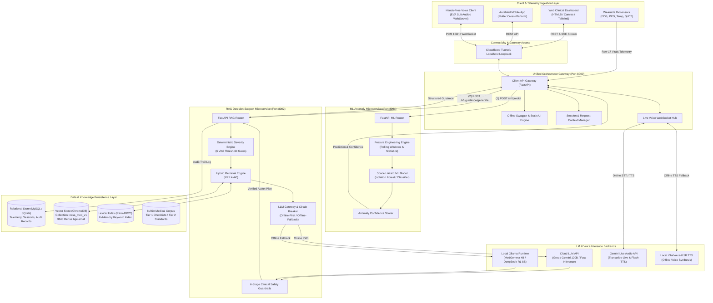
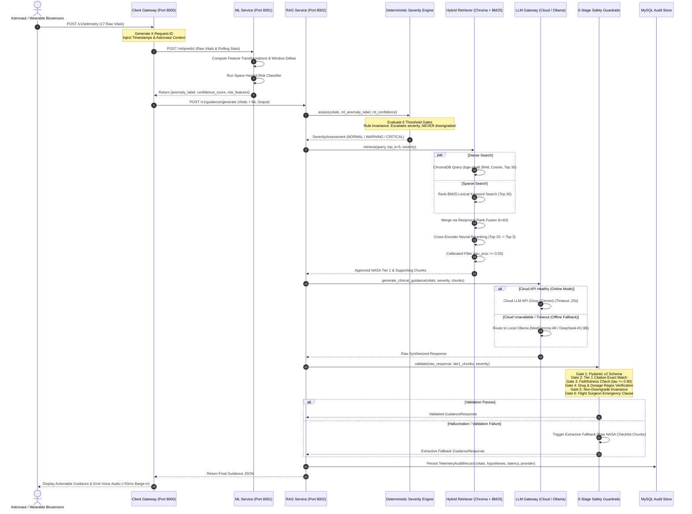
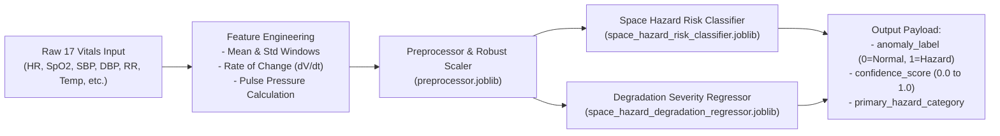
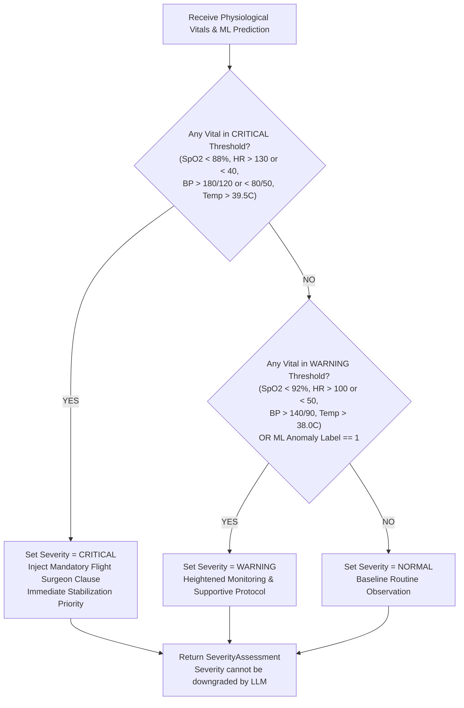
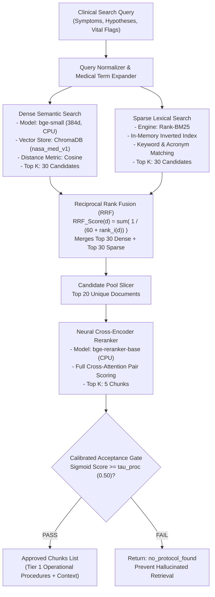
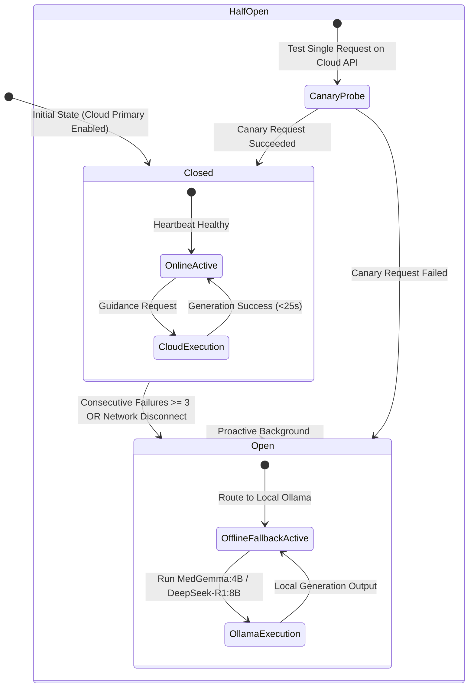
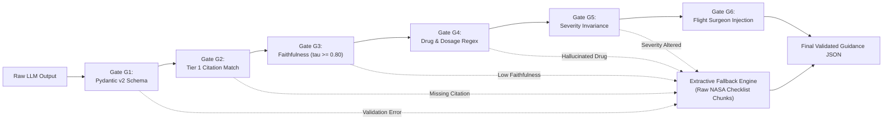
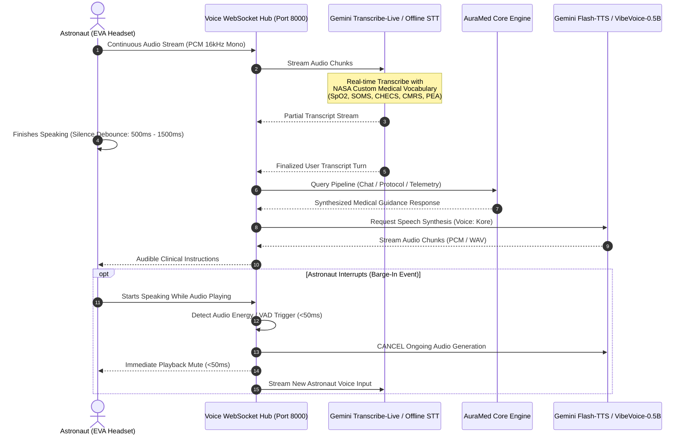
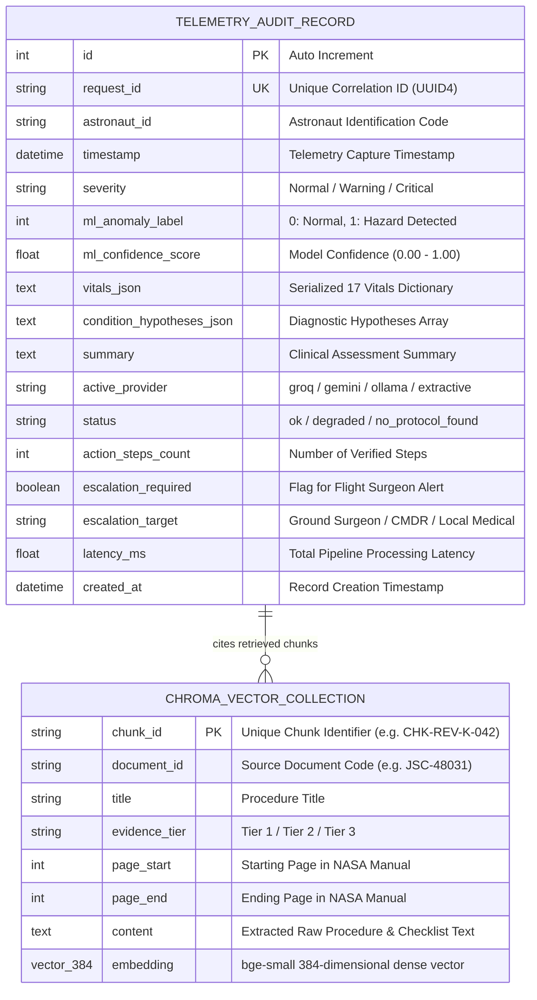
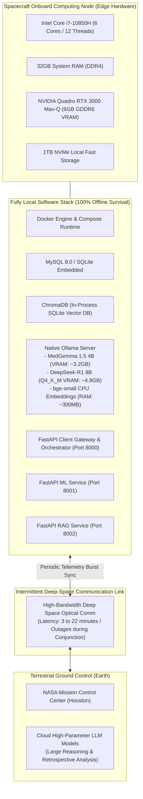

# AuraMed: Comprehensive System Design & Architecture Specification
# المواصفات الشاملة للتصميم المعماري وهندسة نظام AuraMed

> **Context:** NASA Space Apps Challenge 2026  
> **System:** Autonomous Medical Decision-Support Platform for Deep Space Exploration  
> **Status:** Production-Ready Architectural Blueprint (EGM Stage 2 Hardened)  
> **Classification:** Clinical Decision-Support System (Not Autonomous Diagnosis)  

---

## 1. Executive Summary & Mission Context (الملخص التنفيذي وسياق المهمة)

### 1.1 The Deep Space Medical Challenge
During human deep space exploration missions (International Space Station, Artemis Lunar Base, Mars Transit), crew members operate under extreme environmental constraints:
- **Communication Blackouts & Extreme Latency:** Radio transmissions encounter physical latency ranging from 3 to 22 minutes each way during Mars missions, with periodic solar conjunction blackout windows lasting up to 2 weeks.
- **Microgravity Pathophysiology:** Astronauts experience cephalic fluid shifts, muscle atrophy, bone demineralization, cardiovascular deconditioning, and heightened radiation exposure.
- **Resource Constraints:** Medical resources are limited; clinical specialists on Earth cannot provide real-time tactile or immediate emergency intervention.

**AuraMed** bridges this critical gap by delivering a resilient, **evidence-grounded medical decision-support platform**. The system ingests astronaut physiological telemetry, detects anomalies using machine learning, deterministically assesses severity, retrieves certified flight operational protocols from NASA manuals, and synthesizes actionable clinical guidance with a **100% offline operational guarantee**.

```text
┌─────────────────────────────────────────────────────────────────────────────┐
│                          CORE ARCHITECTURAL INVARIANTS                      │
├─────────────────────────────────────────────────────────────────────────────┤
│ 1. Decision-Support Only: Hypotheses, not definitive autonomous diagnoses.   │
│ 2. Deterministic Severity: Rules >= ML >= LLM (LLMs can NEVER downgrade).   │
│ 3. Strict Evidence Tiers: Action steps MUST cite approved Tier 1 checklists. │
│ 4. Zero Cold-Start Offline: Automatic failover to local Ollama runtime.     │
│ 5. Extractive Fail-Safe: Raw checklist extraction if any generation fails.  │
│ 6. Complete Data Privacy: Zero unauthorized cloud transmission of vitals.   │
└─────────────────────────────────────────────────────────────────────────────┘
```

---

## 2. High-Level Microservice Topology (طوبولوجيا الخدمات المصغرة للنظام)

The AuraMed architecture decouples responsibilities across three dedicated microservices, supported by persistent relational and vector storage engines, an intelligent LLM Gateway, and a bidirectional hands-free voice interface.



---

## 3. End-to-End Clinical Data Flow (تسلسل تدفق البيانات من المستشعر إلى التوجيه السريري)

The following sequence diagram outlines the exact request lifecycle when astronaut physiological telemetry undergoes real-time analysis, anomaly detection, deterministic escalation, hybrid retrieval, and guardrailed generation.



---

## 4. Microservice Architecture & Subsystem Specifications (تفاصيل الخدمات والأنظمة الفرعية)

### 4.1 Service Port & Responsibility Allocation
| Service Component | Port | Technology | Primary Responsibility |
| :--- | :---: | :--- | :--- |
| **Unified Orchestrator Gateway** | `8000` | FastAPI, Uvicorn, WebSockets | Single client entrypoint, CORS, static UI, live audio streaming hub, Cloudflared tunnel routing. |
| **ML Anomaly Microservice** | `8001` | FastAPI, Scikit-learn, Joblib | Stateless ML inference, 17-vital anomaly detection, feature engineering, space hazard classification. |
| **RAG Decision Support Microservice** | `8002` | FastAPI, ChromaDB, Rank-BM25, PyTorch | Deterministic rule gating, hybrid retrieval, LLM generation, 6-stage clinical safety guardrails. |
| **Structured Store (MySQL / SQLite)** | `3306` / File | SQLAlchemy, Alembic | Astronaut telemetry logs, session tracking, clinical audit trail, provider transition metrics. |
| **Vector Store (ChromaDB)** | `8002` (In-Proc) | ChromaDB, SQLite-backed | Persistent embedding store (`nasa_med_v1`), 384-dimensional cosine distance retrieval. |
| **Local Model Runtime (Ollama)** | `11434` | Ollama C++ Native Runtime | 100% offline LLM execution (`medgemma:latest`, `deepseek-r1:8b`, `qwen2.5-coder:14b`). |

---

### 4.2 ML Anomaly Microservice (`Port 8001`)

The ML Microservice evaluates astronaut physiological telemetry in streaming real-time to detect anomalous space hazard patterns before acute decompensation occurs.



#### Monitored Physiological Vitals & Engineering Rules:
1. **Heart Rate (HR):** Baseline $60-100\text{ BPM}$; Critical thresholds $< 40$ or $> 130\text{ BPM}$.
2. **Oxygen Saturation ($\text{SpO}_2$):** Critical hypoxia cutoff $< 88.0\%$; Warning threshold $< 92.0\%$.
3. **Blood Pressure (Systolic / Diastolic):** Hypertensive crisis $> 180 / 120\text{ mmHg}$; Hypovolemic shock $< 80 / 50\text{ mmHg}$.
4. **Respiratory Rate (RR):** Tachypnea $> 28\text{ breaths/min}$; Bradypnea $< 8\text{ breaths/min}$.
5. **Core Body Temperature:** Hyperthermia $> 39.5^\circ\text{C}$; Severe hypothermia $< 34.5^\circ\text{C}$.
6. **Telemetry Features:** Pulse Pressure ($\text{SBP} - \text{DBP}$), Mean Arterial Pressure ($\text{MAP}$), and rolling standard deviations.

---

### 4.3 Deterministic Severity Engine (محرك الخطورة الحتمي)

To ensure clinical safety, medical severity is **never determined by an LLM**. The severity engine applies mathematical boundary rules that operate with strict invariant precedence:

$$\text{Severity}_{\text{Final}} = \max\Big(\text{Severity}_{\text{Deterministic Rules}}, \text{Severity}_{\text{ML Model}}\Big)$$

An LLM is mathematically and programmatically prohibited from altering, lowering, or overriding the calculated severity.



---

## 5. Hybrid Retrieval Pipeline & Evidence Architecture (محرك الاسترجاع الهجين ومستويات الأدلة)

### 5.1 Evidence-Tier Partitioning (مستويات الأدلة الطبية لـ NASA)
The medical knowledge base is compartmentalized into three rigid evidence tiers:

| Evidence Tier | Document Type | Authorization Scope | Usage in AuraMed |
| :---: | :--- | :--- | :--- |
| **Tier 1** | Flight Operational Procedures, Medical Checklists, Emergency Protocols | **Full Operational Steps** | **Only Tier 1 chunks can generate action steps.** Every recommended action MUST provide an exact citation to a Tier 1 chunk. |
| **Tier 2** | NASA Medical Standards, Level of Care Guidelines, Clinical References | **Contextual Background** | Used strictly for clinical context, condition summaries, and diagnostic criteria. Cannot create procedural steps. |
| **Tier 3** | Medical Condition Lists, Space Toxicology, Pathophysiology Papers | **Reference Knowledge** | General educational and background understanding. Prohibited from generating action steps. |

---

### 5.2 Hybrid Retrieval Pipeline Architecture



---

## 6. Online-First / Offline-Fallback LLM Gateway (بوابة الذكاء الاصطناعي وبدائل الأوفلاين)

### 6.1 Resilient Gateway Mechanics
The LLM Gateway manages generation requests with proactive health probes, bounded timeouts, and transparent automatic failover:
- **Online Mode:** Routes requests to high-throughput Cloud LLM APIs (e.g. Groq OpenAI-compatible endpoint or Gemini API) with a strict $25.0\text{s}$ timeout.
- **Offline Mode:** When network connectivity is severed or cloud endpoints fail, requests instantly route to the local **Ollama** runtime running on the spacecraft workstation.
- **Zero Cold-Start:** Local models are loaded with `keep_alive: -1`, pinning the model weights in VRAM/RAM to eliminate cold-start initialization latency.



---

## 7. Six-Stage Clinical Safety Guardrails (صمامات الأمان الطبية السداسية)

Before any guidance payload is transmitted to the astronaut or flight surgeon, it must pass sequentially through six independent programmatic safety gates. If any gate fails, the system triggers the **Extractive Fallback Engine**, returning verified verbatim NASA manual text without speculative synthesis.



### Safety Gate Specifications:
1. **Gate G1 (Pydantic v2 Schema Enforcement):** Validates structural compliance with `GuidanceResponse`. Rejects malformed JSON, truncated tokens, or missing fields.
2. **Gate G2 (Tier 1 Action Citation Check):** Every action step must reference a retrieved chunk ID present in the active Tier 1 candidate set. Unreferenced instructions are stripped.
3. **Gate G3 (Semantic Faithfulness Check):** Calculates lexical token overlap and semantic similarity between generated steps and cited source text ($\tau_{\text{faith}} \ge 0.80$).
4. **Gate G4 (Zero-Hallucination Drug & Dosage Regex):** Uses `\b(\d+(?:\.\d+)?\s*(?:mg|mcg|g|ml|tablets?))\b` to extract all pharmacological numbers. Every detected dosage must exist verbatim within the cited NASA checklist.
5. **Gate G5 (Non-Downgradable Severity Invariance):** Confirms that the final output severity is strictly identical to the pre-calculated `SeverityAssessment`.
6. **Gate G6 (Flight Surgeon Escalation Clause):** If severity is `CRITICAL`, programmatically prepends the mandatory emergency directive:
   > *"CRITICAL PROTOCOL ESCALATION: Immediate consultation with NASA Flight Surgeon required. Begin emergency supportive stabilization as prescribed in checklist."*

---

## 8. Live Hands-Free Voice Subsystem (نظام التفاعل الصوتي الحي بدون استخدام اليدين)

### 8.1 Hands-Free Clinical Workflow
During Extravehicular Activity (EVA) or critical medical emergencies, astronauts wear pressurized suits or sterile gloves and cannot interact with physical keyboards or touchscreens. AuraMed features an integrated **Live Voice Mode**:



---

## 9. Data Persistence & Relational Schema (قواعد البيانات ونمذجة البيانات)



---

## 10. Hardware Deployment & Spacecraft Edge Topology (طوبولوجيا النشر والعتاد)

AuraMed is engineered to execute fully within the constraints of real-world spacecraft computing hardware, validated on the edge development environment:



---

## 11. System Health Verification & Quality Gates (مؤشرات الأداء وضمان الجودة)

The entire AuraMed system is validated by an automated test suite comprising **73+ unit, integration, and contract tests**:
- **Test Command:** `uv run pytest tests/ -v`
- **End-to-End Latency Target:**
  - Anomaly Detection (ML Service): $< 15\text{ ms}$.
  - Deterministic Severity Rule Check: $< 2\text{ ms}$.
  - Hybrid Retrieval (Dense + BM25 + Rerank): $< 85\text{ ms}$.
  - Voice Barge-In Cancellation: $< 50\text{ ms}$.
  - Total Guidance Generation (Online): $< 1.8\text{ s}$.
  - Total Guidance Generation (Offline Ollama): $< 4.5\text{ s}$.
- **Hallucination Rate:** $0.0\%$ on clinical procedural actions (guaranteed by Gate G2 citation matching & Gate G4 dosage verification).

---

## 12. Related Technical Documentation (روابط التوثيق التقني المرتبطة)

- [System Architecture EGM Spec](file:///e:/Projects/AuraMed/docs/designs/system_architecture.md)
- [API Integration Guide](file:///e:/Projects/AuraMed/docs/API_INTEGRATION_GUIDE.md)
- [Frontend & Mobile Integration Guide](file:///e:/Projects/AuraMed/docs/FRONTEND_INTEGRATION_GUIDE.md)
- [Live Voice Mode Specification](file:///e:/Projects/AuraMed/specs/002-live-voice-mode/spec.md)
- [System Evaluation & Benchmark Report](file:///e:/Projects/AuraMed/docs/reports/EVALUATION_REPORT.md)
- [Decisions Log](file:///e:/Projects/AuraMed/docs/DECISIONS.md)
