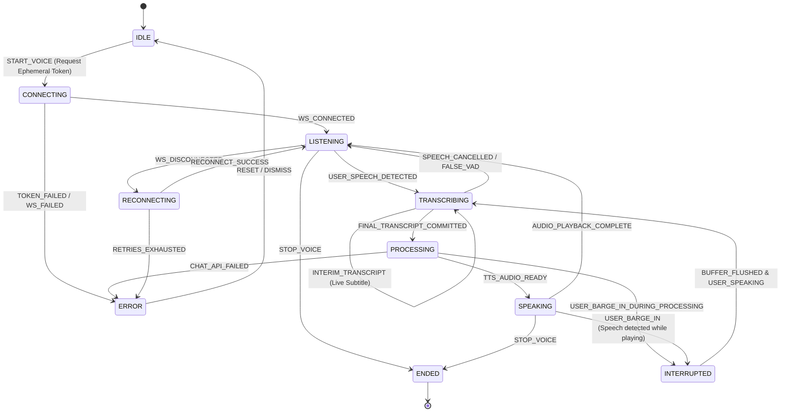

# Data Model & State Machine: Live Voice Conversation Mode
# AuraMed SpecKit 002-live-voice-mode

**Feature Branch**: `002-live-voice-mode`  
**Created**: 2026-11-14  
**Status**: Ready for Planning & Review  

---

## 1. Voice Session State Machine

The Voice Session Manager governs the entire lifecycle of real-time audio capture, transcription, medical copilot consultation, speech synthesis, and natural barge-in interruptions.

### 1.1 State Definitions

| State | Description | Audio In | Audio Out | WebSocket State |
|:---|:---|:---|:---|:---|
| **`IDLE`** | Initial uninitialized state. Microphone inactive. | Muted / Off | Inactive | Closed |
| **`CONNECTING`** | Negotiating ephemeral token and establishing WebSocket stream. | Active (buffering) | Inactive | Connecting |
| **`LISTENING`** | WebSocket open. Streaming audio; awaiting speech or silence. | Streaming (16kHz PCM) | Inactive | Open |
| **`TRANSCRIBING`** | VAD detected speech. Receiving real-time `interim_input_transcription`. | Streaming (16kHz PCM) | Inactive | Open |
| **`PROCESSING`** | Speech finalized. Awaiting `POST /v1/chat` and TTS synthesis. | Active / Monitored | Inactive | Open |
| **`SPEAKING`** | Playing synthesized audio response through speakers. | Active (Interruption VAD) | Playing (24kHz WAV) | Open |
| **`INTERRUPTED`** | User spoke over assistant. Playback stopped, buffer cleared. | Streaming (16kHz PCM) | Aborted | Open |
| **`RECONNECTING`** | Transient network loss or token expiry renewal. | Buffering locally | Paused | Re-establishing |
| **`ERROR`** | Unrecoverable failure (e.g. mic permission denied, all quotas dead). | Inactive | Inactive | Closed |
| **`ENDED`** | Session terminated by user or timeout. Resources released. | Inactive | Inactive | Closed |

---

### 1.2 State Transition Diagram (Mermaid)



---

### 1.3 Transition Event Matrix & Guarantees

| Current State | Event Trigger | Next State | Actions & Guarantees |
|:---|:---|:---|:---|
| `IDLE` | `START_SESSION` | `CONNECTING` | Request ephemeral token from Key Manager; initialize Web Audio mic stream. |
| `CONNECTING` | `WS_OPEN` | `LISTENING` | Start streaming 16kHz PCM chunks (100ms packets); display live audio waveform. |
| `CONNECTING` | `AUTH_ERROR` | `ERROR` | Key Manager attempts credential failover; if exhausted, transition to `ERROR`. |
| `LISTENING` | `VAD_SPEECH_START` | `TRANSCRIBING` | Begin displaying interim subtitle bubble in chat UI. |
| `TRANSCRIBING` | `INTERIM_UPDATE` | `TRANSCRIBING` | Update dynamic subtitle text on screen; zero delay. |
| `TRANSCRIBING` | `SPEECH_FINALIZED` | `PROCESSING` | Append finalized text to history; submit async request to `POST /v1/chat`. |
| `TRANSCRIBING` | `USER_PAUSE (Silence)` | `TRANSCRIBING (Debouncing)` | Start silence timer ($T_{\text{silence}} = 1500\text{ms} - 2000\text{ms}$). If user speaks before timeout, reset timer and merge speech. If timer expires, trigger `SPEECH_FINALIZED`. |
| `PROCESSING` | `CHAT_SUCCESS` | `SPEAKING` | Deterministically format text for TTS; stream audio to client; begin playback. |
| `PROCESSING` | `USER_SPEECH` | `INTERRUPTED` | Cancel ongoing `POST /v1/chat` / TTS task via `AbortController`; transition to new speech turn. |
| `SPEAKING` | `USER_SPEECH` | `INTERRUPTED` | **Barge-in**: Stop `AudioBufferSourceNode` immediately ($<50\text{ms}$); flush audio buffer; mark turn as interrupted. |
| `SPEAKING` | `PLAYBACK_END` | `LISTENING` | Return to ambient listening; microphone remains hot for continuous dialogue. |
| `SPEAKING` | `STOP_SESSION` | `ENDED` | Stop audio playback immediately; close WebSocket; clean up Web Audio context. |
| Any Active | `NET_DISCONNECT` | `RECONNECTING` | Enter exponential retry loop ($1\text{s}, 2\text{s}, 4\text{s}$); buffer mic audio in memory. |
| `RECONNECTING` | `MAX_RETRIES` | `ERROR` | Inform crew of network loss; seamlessly offer offline text Chat mode. |

---

## 2. Key Domain Entities

### 2.1 VoiceSession Entity

```python
class VoiceSessionState(str, Enum):
    IDLE = "IDLE"
    CONNECTING = "CONNECTING"
    LISTENING = "LISTENING"
    TRANSCRIBING = "TRANSCRIBING"
    PROCESSING = "PROCESSING"
    SPEAKING = "SPEAKING"
    INTERRUPTED = "INTERRUPTED"
    RECONNECTING = "RECONNECTING"
    ERROR = "ERROR"
    ENDED = "ENDED"

class VoiceSession(BaseModel):
    session_id: str = Field(default_factory=lambda: f"VSES-{uuid4().hex[:12].upper()}")
    astronaut_id: str = Field(default="ASTRO-01")
    state: VoiceSessionState = Field(default=VoiceSessionState.IDLE)
    created_at: datetime = Field(default_factory=datetime.utcnow)
    last_activity_at: datetime = Field(default_factory=datetime.utcnow)
    
    # Active Google Cloud Project routing
    active_project_id: Optional[str] = None
    ephemeral_token_expires_at: Optional[datetime] = None
    
    # Conversation tracking
    turns_count: int = 0
    language_detected: str = "auto"
    interrupted_count: int = 0
    
    # Audio settings
    sample_rate_hz: int = 16000
    voice_name: str = "Kore"  # Recommended default for flight surgeon guidance
```

---

### 2.2 VoiceTurn Entity

```python
class VoiceTurn(BaseModel):
    turn_id: str = Field(default_factory=lambda: f"TURN-{uuid4().hex[:8].upper()}")
    session_id: str
    turn_number: int
    started_at: datetime = Field(default_factory=datetime.utcnow)
    completed_at: Optional[datetime] = None
    
    # Transcription
    user_transcript: str
    transcript_confidence: float = 1.0
    language_code: Optional[str] = None
    is_interrupted: bool = False
    
    # Linked Existing Medical Response
    clinical_response: Optional[ChatMessageResponse] = None
    spoken_script: Optional[str] = None
    
    # Telemetry & Performance
    stt_latency_ms: float = 0.0
    copilot_latency_ms: float = 0.0
    tts_latency_ms: float = 0.0
    total_latency_ms: float = 0.0
```

---

### 2.3 Google Project & Credential Entities

```python
class CredentialStatus(str, Enum):
    ACTIVE = "ACTIVE"
    RATE_LIMITED = "RATE_LIMITED"  # Temporary cooldown
    REVOKED = "REVOKED"            # 401/403 permanent disable
    DISABLED = "DISABLED"

class GeminiCredential(BaseModel):
    credential_id: str
    project_id: str
    key_hash: str                   # SHA-256 hash of API key for safe tracking
    masked_key: str                 # e.g. "AQ.Ab8...5ew"
    priority: int = 1
    status: CredentialStatus = CredentialStatus.ACTIVE
    consecutive_failures: int = 0
    last_failure_reason: Optional[str] = None
    last_used_at: Optional[datetime] = None
    total_calls_succeeded: int = 0
    total_calls_failed: int = 0

class GoogleProjectBucket(BaseModel):
    project_id: str
    priority: int = 1
    is_active: bool = True
    cooldown_until: Optional[datetime] = None
    current_rpm: int = 0
    requests_today: int = 0
    consecutive_project_429s: int = 0
    credentials: List[GeminiCredential] = Field(default_factory=list)
```

---

### 2.4 Spoken Medical Script Entity

```python
class SpokenMedicalScript(BaseModel):
    raw_markdown: str
    spoken_summary: str
    spoken_action_steps: List[str]
    spoken_escalation: Optional[str]
    full_spoken_script: str
    voice_name: str
    speech_style: str = "calm, articulate, authoritative flight surgeon"
    language: str = "en"  # or "ar"
    preserved_chunk_ids: List[str]
```

---

## 3. Cooldown & Rate Limit Algorithm

When a project returns HTTP 429 (`RESOURCE_EXHAUSTED`):
1. **Cooldown Calculation**:
   $$\Delta T_{\text{cooldown}} = \min(T_{\text{base}} \times 2^{\text{failures}} + \text{Uniform}(0, \text{Jitter}), T_{\text{max}})$$
   - $T_{\text{base}} = 30 \text{ seconds}$
   - $T_{\text{max}} = 300 \text{ seconds}$
   - $\text{Jitter} = 5 \text{ seconds}$
2. **Project Suspension**: Set `cooldown_until = now() + \Delta T_{\text{cooldown}}`.
3. **Failover Execution**: Key Manager queries the highest-priority `GoogleProjectBucket` where `is_active == True` and `cooldown_until <= now()`.
4. **Key Selection**: Within the eligible project, select the key with lowest `consecutive_failures` and least recent usage (round-robin / least-busy).

---

## 4. Invariance & Audit Recording

Every voice interaction creates a permanent record in the existing MySQL database:
1. `chat_session_id`: Preserved across text and voice modes.
2. `interaction_modality`: Tagged as `"voice"` in audit logs.
3. `exact_medical_response_json`: Verbatim JSON payload preserved in database identical to text chat.
4. `spoken_script_hash`: SHA-256 hash verifying that the spoken script contained no modifications to dosages or procedures.
